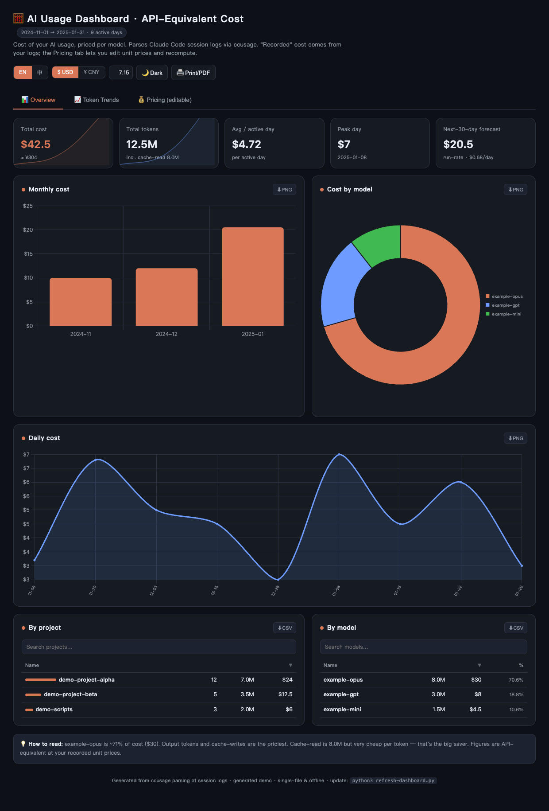

# AI Usage Dashboard

A single-file, offline dashboard that shows **how much your AI coding usage would cost at API prices** — broken down by month, model, and project. It parses your local [Claude Code](https://docs.anthropic.com/claude/docs/claude-code) session logs via [ccusage](https://github.com/ryoppippi/ccusage), then generates one self-contained `usage-dashboard.html` you can open anywhere (no server, works offline — Chart.js is inlined).

> **What makes it different from `ccusage`:** an interactive, shareable dashboard with an **editable pricing model**. If you pay through a discounted relay/proxy, the `--infer-prices` mode reverse-engineers your **effective per-token unit prices** from your own recorded cost — something raw ccusage doesn't surface. (It's based on *your* records, not universal list prices.)

 <!-- add your own screenshot here -->

## Features

- 📊 **Overview** — total cost, tokens, daily average, peak day, and a 30-day forecast; monthly trend, model split, daily detail, project & model tables.
- 📈 **Token trends** — stacked monthly tokens by model, top-model lines, and a 4-type token mix (input / output / cache-write / cache-read).
- 💰 **Pricing (editable)** — per-model unit prices you can edit; the dashboard recomputes cost live and forecasts next-30-day spend. Defaults to **official list prices**; `--infer-prices` backs out your effective rates.
- 🌗 Dark / light theme · 🌐 English / 中文 · 💱 USD ⇄ CNY with editable rate.
- ⬇️ Export charts as PNG, tables as CSV, or print to PDF — all offline.
- 🔎 Sort & search tables · click a month or model to drill down.
- Preferences (theme, language, currency, edited prices) persist in your browser.

## Quick start

```bash
# 1. Requirements: python3 + Node.js (npx). ccusage is fetched automatically.
# 2. Generate your dashboard:
python3 refresh-dashboard.py

# 3. Open the result:
open usage-dashboard.html        # macOS
# xdg-open usage-dashboard.html  # Linux
# start usage-dashboard.html     # Windows
```

`template.html` ships with **demo data** so you can preview the UI immediately; running the script replaces it with your real usage and writes `usage-dashboard.html`.

## Options

```
python3 refresh-dashboard.py [options]

--infer-prices         Reverse-engineer your effective unit prices from recorded
                       cost (use this if you're on a discounted relay/proxy).
                       Default: official published list prices.
--claude-dir PATH      Path to your .claude directory
                       (default: ~/.claude, or %USERPROFILE%\.claude on Windows).
--output PATH          Output HTML path (default: ./usage-dashboard.html).
--rate N               Default USD→CNY rate shown in the UI (default: 7.15).
```

Examples:

```bash
python3 refresh-dashboard.py --infer-prices
python3 refresh-dashboard.py --claude-dir /custom/.claude --output ~/Desktop/usage.html
python3 refresh-dashboard.py --rate 7.2
```

## How pricing works

Cost is computed per model across four token categories:

```
cost = Σ_model ( Σ_4types tokens ÷ 1e6 × unit_price )
```

- **Default (official mode):** unit prices come from each model family's published list price. For direct-API users, *Recompute ≈ Recorded*.
- **`--infer-prices` (inferred mode):** unit prices are solved from your recorded cost using standard input:output:cache ratios, so *Recompute ≈ Recorded* even with a discount. These are **your effective rates**, not universal prices.

You can always edit any price in the **Pricing** tab and recompute — edits are saved in your browser.

## Data source & scope

- Currently supports **Claude Code logs only** (that's what ccusage parses).
- Want OpenAI / Cursor / OpenRouter / other sources? Open an issue 👍 — contributions welcome.
- The tool reads your logs locally and writes a local HTML file. Nothing is uploaded.

## Privacy

The generated `usage-dashboard.html` contains your real spend figures and decoded project names. It's **git-ignored by default** — don't commit it. Only `template.html` (demo data) is tracked.

## Project layout

```
ai-usage-dashboard/
├── refresh-dashboard.py   # fetches usage, injects data into the template
├── template.html          # the dashboard UI + demo data (no real data)
├── usage-dashboard.html   # generated output (git-ignored)
├── README.md
├── LICENSE
└── .gitignore
```

The template and data are decoupled: the script only replaces the block between
`/* ===DASHBOARD-DATA-START=== */` and `/* ===DASHBOARD-DATA-END=== */`, leaving
the UI and inlined Chart.js untouched — so it's idempotent and safe to re-run.

## License

MIT — see [LICENSE](LICENSE).

---

## 中文简介

一个**单文件、离线**的 AI 用量成本看板:把你本地 Claude Code 的会话日志(通过 ccusage 解析)按**月 / 模型 / 项目**折算成 API 等价花费,生成一个可直接打开、可分享的 `usage-dashboard.html`(Chart.js 已内联,断网可用)。

**与 ccusage 的差异点:** 交互式看板 + **可编辑的计费模型**。如果你走折扣中转,`--infer-prices` 会从你自己的记录里**反推出实际每 token 单价**——这是 ccusage 不提供的(注意:基于你自己的记录,并非通用公开价)。

```bash
python3 refresh-dashboard.py          # 默认用官方价
python3 refresh-dashboard.py --infer-prices   # 反推你的实际折扣单价
# 然后用浏览器打开 usage-dashboard.html
```

功能:概览 / 模型 Token 曲线 / 计费逻辑(可改价重算)、明暗主题、中英切换、USD⇄CNY、导出 PNG/CSV/PDF、表格排序搜索、月份与模型下钻、30 天成本预测。偏好与改价存在浏览器本地。

目前仅支持 Claude Code 日志;需要 OpenAI/Cursor/OpenRouter 等可提 issue。生成的 HTML 含真实花费,已默认在 `.gitignore` 中,请勿提交。
